<div align="center">

# PRISMA-Agent

### An agentic AI pipeline for rigorous, transparent and reproducible systematic reviews on any topic

*Research question in → PRISMA 2020 systematic review out: protocol, multi-database search, dual screening, full-text RAG, verified extraction, risk of bias, synthesis, critique and manuscript.*

`LangGraph` · `multi-agent` · `human-in-the-loop` · `hybrid RAG` · `MCP` · `100 % local LLMs`

</div>

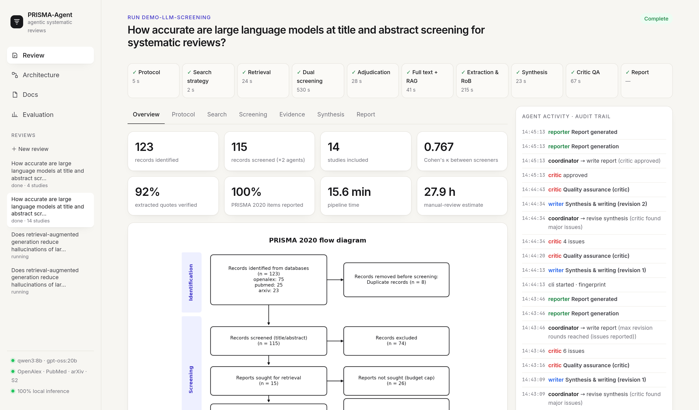

## Contents

1. [Highlights](#highlights)
2. [Demonstration on a real topic](#demonstration-on-a-real-topic)
3. [Architecture](#architecture)
4. [The agents](#the-agents)
5. [How it satisfies the brief](#how-it-satisfies-the-brief)
6. [Installation](#installation)
7. [Usage](#usage)
8. [Evaluation](#evaluation)
9. [Screenshots](#screenshots)
10. [Project structure](#project-structure)
11. [Development steps](#development-steps)
12. [Team and individual contribution](#team-and-individual-contribution)
13. [Video and presentation](#video-and-presentation)

**📄 The systematic literature review (paper):** [paper/Haddad_SLR_LLM_Screening.pdf](paper/Haddad_SLR_LLM_Screening.pdf) (LaTeX source in [`paper/`](paper))

Detailed documents: [Architecture](docs/ARCHITECTURE.md) · [User guide](docs/USER_GUIDE.md) · [Evaluation](docs/EVALUATION.md) · [Technical report (PDF)](docs/technical_report.pdf) · [Presentation](presentation/slides.pdf)

---

## Highlights

| | |
|---|---|
| 🧭 **8 specialised agents + coordinator** | planner, search strategist, retrieval, two independent screeners, adjudicator, full-text/extraction/appraisal, writer, critic |
| 🔁 **Stateful LangGraph workflow** | loops (broaden the search, revise the synthesis), conditional routing, `RetryPolicy`, SQLite checkpoints, **time-travel replay** from any stage |
| ✋ **Human-in-the-loop** | `interrupt()` checkpoints: protocol approval/editing and reviewer-conflict resolution, in the web app or the terminal |
| 📚 **4 scholarly sources** | OpenAlex · PubMed (MeSH) · arXiv · Semantic Scholar, cached and rate-limited, deduplicated by DOI + fuzzy title |
| 🔎 **Hybrid RAG** | FAISS dense + BM25 sparse → reciprocal rank fusion → FlashRank cross-encoder → context compression |
| ✅ **Verified evidence** | every extracted value carries a verbatim quote + chunk id, checked automatically against the PDF (92% verified in the demo) |
| ⚖️ **Independent judgement** | the worker model (`qwen3:8b`) is checked by a different model family (`gpt-oss:20b`) for adjudication and critique |
| 🧾 **Full audit trail** | every decision, tool call and LLM call in `trace.jsonl`; `manifest.json` with seeds, model digests and a config fingerprint |
| 📄 **Publication-ready outputs** | PRISMA 2020 flow diagram, risk-of-bias traffic light, evidence map, results plot, manuscript (Markdown + DOCX), BibTeX, CSV, checklist |
| 🔌 **MCP server** | `search_literature`, `run_review`, `list_reviews`, `get_report`, usable from any MCP client |
| 🔒 **100 % local** | Ollama models: private, free, reproducible |

## Demonstration on a real topic

> **"How accurate are large language models at title and abstract screening for systematic reviews?"**

| | |
|---|---|
| Records identified → screened → included | **123 → 115 → 14 studies** (OpenAlex, PubMed, arXiv) |
| Agreement between the two screening agents | **Cohen's κ = 0.767** (13 conflicts adjudicated) |
| Extracted quotes verified in the source text | **92%** |
| PRISMA 2020 checklist | **27/27 items** reported |
| Critic | 3 rounds → approved |
| Time | **15.6 min** end-to-end vs **~27.9 h** of manual reviewer time (**×107.3**) |

**Answer produced by the agents** (excerpt of the [generated manuscript](runs/demo-llm-screening/report.md)):

> Large language models (LLMs) demonstrate high sensitivity in title and abstract screening for systematic reviews, with some studies reporting perfect sensitivity (100%) [S037], while specificity varies more widely, ranging from 81% [S037] to 99.9% [S034]. Overall accuracy ranges from 85.1% [S008] to 99.9% [S034]. However, the trade-off between sensitivity and specificity is a key consideration, as some models prioritize sensitivity at the expense of specificity. Time efficiency is also notable, with some studies reporting a 75% reduction in screening workload [S034] and others noting that LLMs can complete screening in under 1 day for a fraction of the cost of human screening [S033]. While LLMs show strong inter-rater agreement with human reviewers in some cases [S034], variability in performance across domains and prompting strategies suggests that further refinement is needed for consistent and reliable use.

<table><tr>
<td>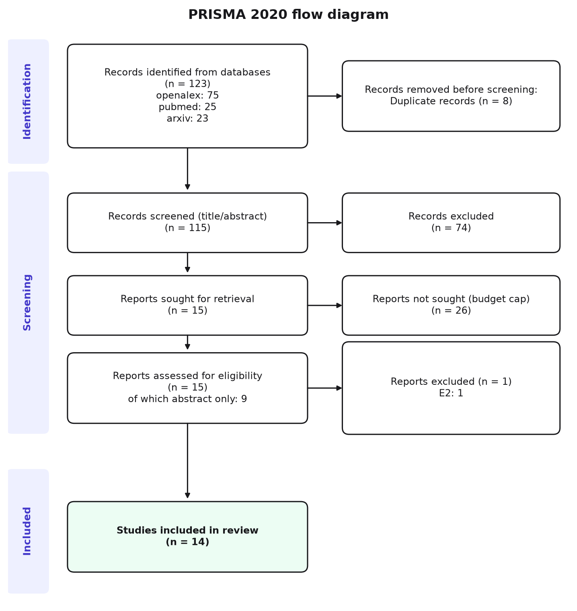</td>
<td>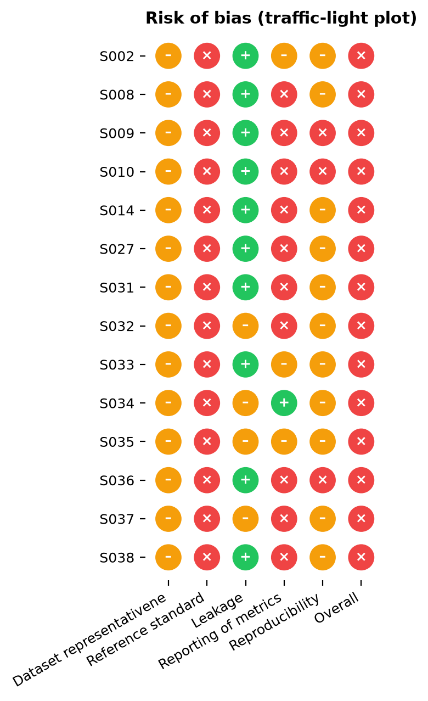<br>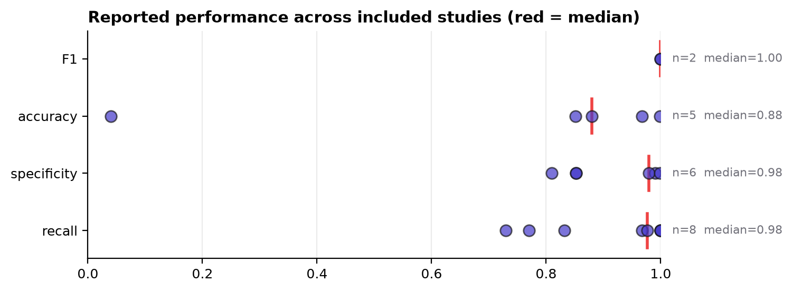</td>
</tr></table>

All artefacts of this run are in [`runs/demo-llm-screening/`](runs/demo-llm-screening): [manuscript](runs/demo-llm-screening/report.md) ([DOCX](runs/demo-llm-screening/report.docx)), [protocol](runs/demo-llm-screening/protocol.json), [screening log](runs/demo-llm-screening/screening_log.csv), [evidence table](runs/demo-llm-screening/evidence_table.csv), [BibTeX](runs/demo-llm-screening/references.bib), [PRISMA checklist](runs/demo-llm-screening/prisma_checklist.json), [audit trail](runs/demo-llm-screening/trace.jsonl), [manifest](runs/demo-llm-screening/manifest.json).

### Second example: works on any topic

> **"Does retrieval-augmented generation reduce hallucinations of large language models?"**, run in **human-in-the-loop** mode from the web app ([artefacts](runs/20261115-145329-does-retrieval-augmented-generation-redu), [manuscript](runs/20261115-145329-does-retrieval-augmented-generation-redu/report.md))

- **Pipeline:** 53 records from all 4 sources (Semantic Scholar answered this time) → 46 screened → 5 studies included, in 6.6 min.
- **Checks:** 100 % of quotes verified; the critic approved after 2 rounds.
- **Low agreement:** the screeners agreed poorly on this broader question (κ = 0.04, 15 conflicts). This is exactly when **checkpoint 2** matters. The run paused and the conflicts were resolved in the UI panel.

| Checkpoint 2: resolving reviewer conflicts |
|---|
| 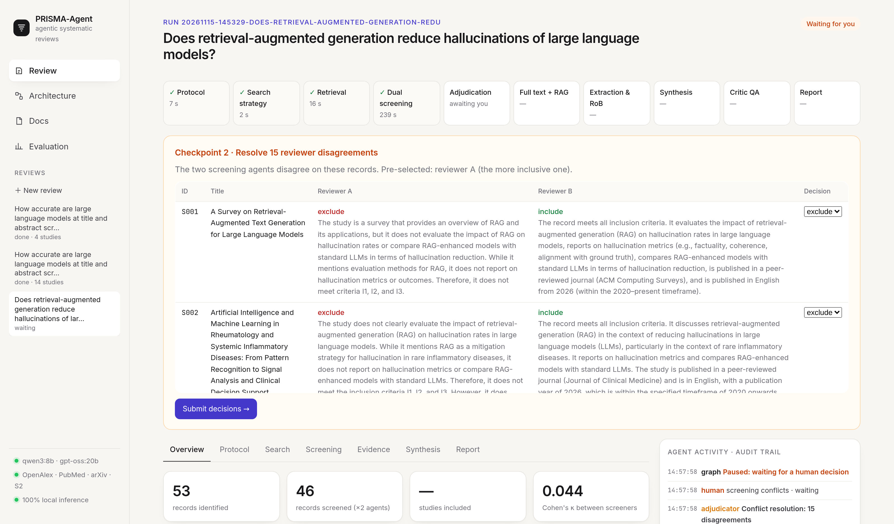 |

## Architecture

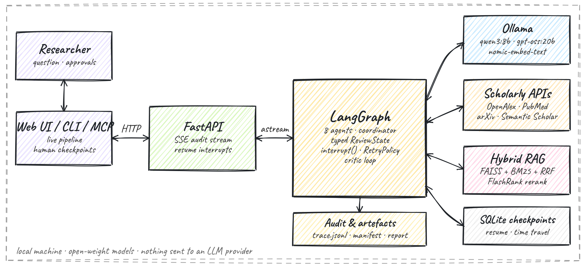

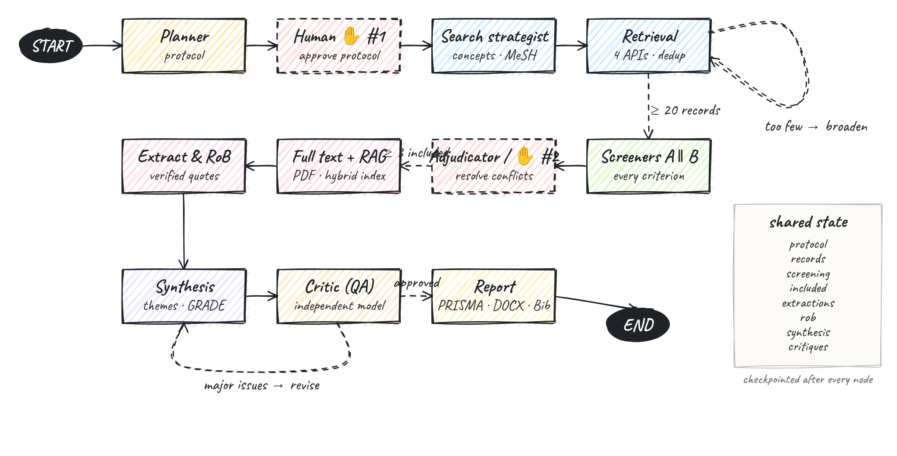

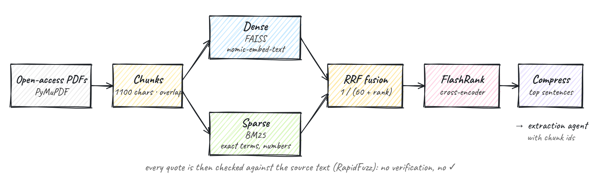

The full explanation (state, nodes, edges, RAG, design decisions, observability) is in **[docs/ARCHITECTURE.md](docs/ARCHITECTURE.md)**.

## The agents

| Agent | Role | Safeguards |
|---|---|---|
| **Coordinator** | Routes between stages; loops back to broaden the search (< 20 records or < 3 included) or to revise the synthesis | every routing decision logged with its reason |
| **Planner** | PRISMA 2020 protocol: PICO / PCC / SPIDER, numbered criteria, RoB domains, synthesis plan | human approval / editing (checkpoint #1) |
| **Search strategist** | Concept blocks, synonyms, MeSH, keyword queries | deterministic compiler to valid PubMed / arXiv / Boolean syntax |
| **Retrieval** | 4 APIs in parallel, deduplication, open-access PDF download, hybrid index | cached responses, retries, dated search log |
| **Screeners A ‖ B** | Independent title/abstract screening: each criterion yes / no / unclear + rationale | κ agreement, exclude only on a clear violation |
| **Adjudicator** | Resolves A/B conflicts (`gpt-oss:20b`) | or the human (checkpoint #2) |
| **Extractor & appraiser** | Structured data extraction from RAG passages; risk of bias per domain | verbatim quotes verified; overall RoB = worst domain |
| **Writer** | Thematic synthesis, GRADE-style certainty, meta-analysis feasibility | evidence-table only, citation ids |
| **Critic** | QA: unsupported claims, numbers, certainty, coverage | deterministic citation checks + independent model; revise loop |

## How it satisfies the brief

| Requirement | Implementation |
|---|---|
| Modular multi-agent architecture (LangChain/LangGraph) | `prisma_agent/graph.py`, `agents.py`: 11 nodes, conditional edges, coordinator loops |
| Advanced RAG over scientific corpora | `rag.py`: hybrid dense + sparse, RRF, cross-encoder re-ranking, compression, chunk-level provenance |
| PubMed, Semantic Scholar, arXiv, OpenAlex | `sources/clients.py` |
| PRISMA workflow: protocol → search → dual screening → extraction → RoB → synthesis → report | one node per stage + `report.py` (27-item PRISMA checklist auto-validated) |
| Boolean / MeSH search strategies | search strategist + compiler (`compile_queries`) |
| Transparency: logging, citation tracking, rationales, traces | `trace.jsonl`, criterion-level rationales, verified quotes with chunk ids, `manifest.json` |
| Human-in-the-loop at critical decisions | `interrupt()` at protocol and conflicts; web UI panels and CLI prompts |
| Any topic, minimal configuration | one question in; the protocol framework is chosen automatically (PICO / PCC / SPIDER) |
| Persistent memory, versioning, audit trails | SQLite checkpoints (resume, time-travel `replay`), config fingerprint, model digests |
| PRISMA flow data, evidence maps, manuscript draft | `prisma_flow.png/svg`, `evidence_map.png`, `report.md/.docx`, `references.bib` |
| Evaluation: completeness, accuracy, consistency, time savings | `scripts/evaluate.py` → [docs/EVALUATION.md](docs/EVALUATION.md) |

## Installation

```bash
# 1. Local models
curl -fsSL https://ollama.com/install.sh | sh
ollama pull qwen3:8b && ollama pull gpt-oss:20b && ollama pull nomic-embed-text

# 2. Python 3.11
git clone https://github.com/HADDADmed/M1_final_project.git && cd M1_final_project
python3.11 -m venv .venv && source .venv/bin/activate
pip install -r requirements.txt
```

## Usage

```bash
# Web app: live pipeline, human checkpoints, results, docs, evaluation
uvicorn prisma_agent.server:app --port 8000          # → http://127.0.0.1:8000

# Terminal
python -m prisma_agent.cli run "Does retrieval-augmented generation reduce LLM hallucinations?" --hitl human
python -m prisma_agent.cli replay <run_id> --from-node synthesis     # time travel: re-run from a stage
python -m prisma_agent.cli show <run_id>

# MCP server (stdio) for any MCP client
python -m prisma_agent.mcp_server

# Quality
pytest                                                # unit tests
python scripts/evaluate.py <run_id>                   # evaluation report
```

The options, outputs and troubleshooting are in the [user guide](docs/USER_GUIDE.md).

## Evaluation

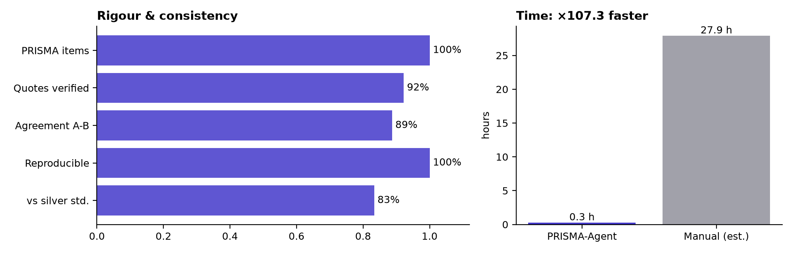

| Dimension | Metric | Result |
|---|---|---|
| Completeness | PRISMA 2020 items reported | **27/27** |
| Accuracy | Quotes verified verbatim in the source | **92%** |
| Accuracy | Agreement with an independent silver standard (gpt-oss:20b, n=30) | **83%** (sensitivity 86%, specificity 83%) |
| Accuracy | Known key papers retrieved | 2/4 |
| Consistency | Cohen's κ, screener A vs B | **0.767** |
| Consistency | Identical decisions on re-run (reproducibility) | **100%** |
| Time | Pipeline vs manual estimate | **15.6 min vs ~27.9 h (×107.3)** |

The method and caveats are in [docs/EVALUATION.md](docs/EVALUATION.md).

## Screenshots

| Start a review | Checkpoint 1: approve the protocol |
|---|---|
| 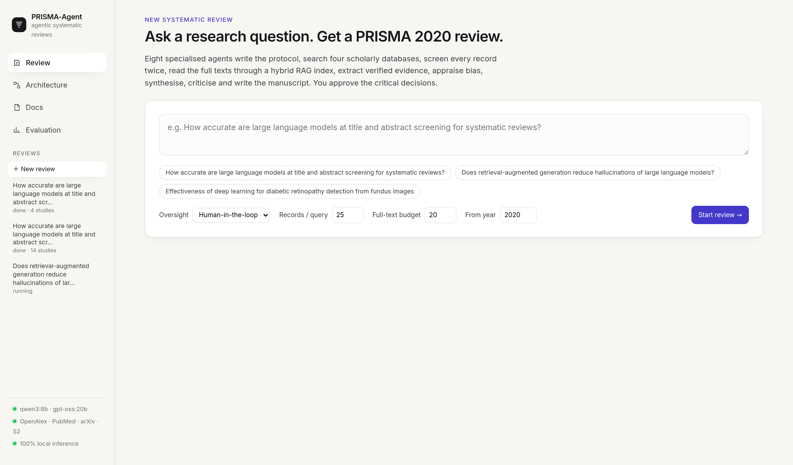 | 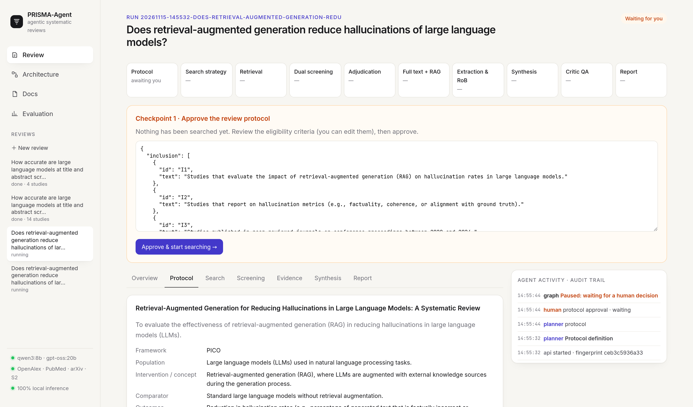 |
| **Agents at work (live audit trail)** | **Dual screening with rationales** |
| 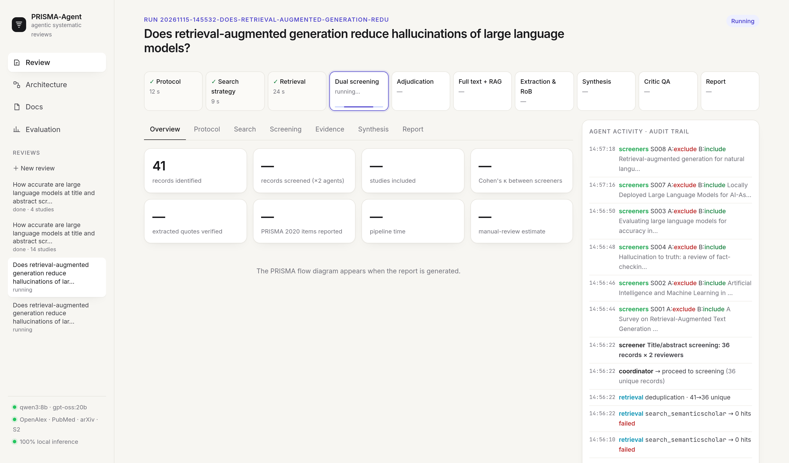 | 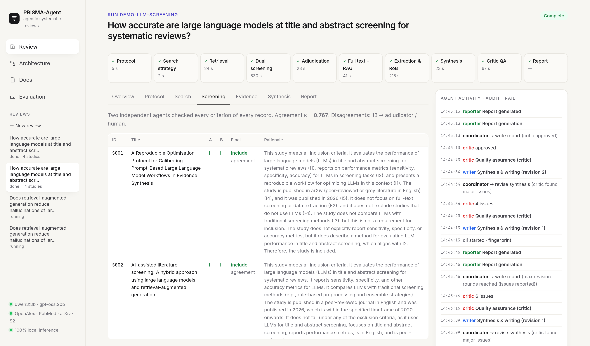 |
| **Verified evidence & risk of bias** | **Synthesis + critic** |
| 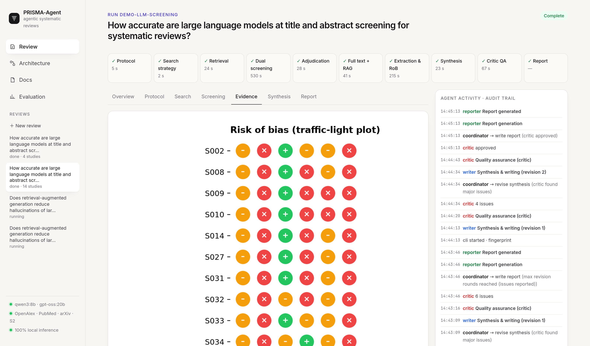 | 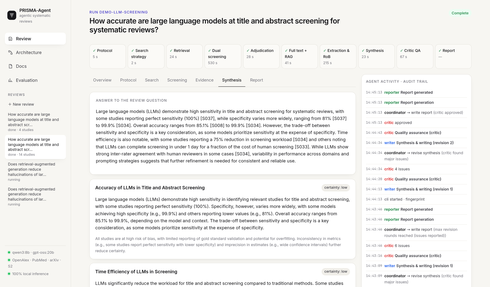 |
| **Generated manuscript & downloads** | **Evaluation** |
| 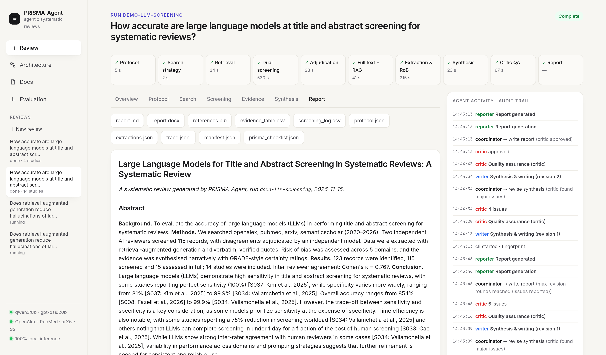 | 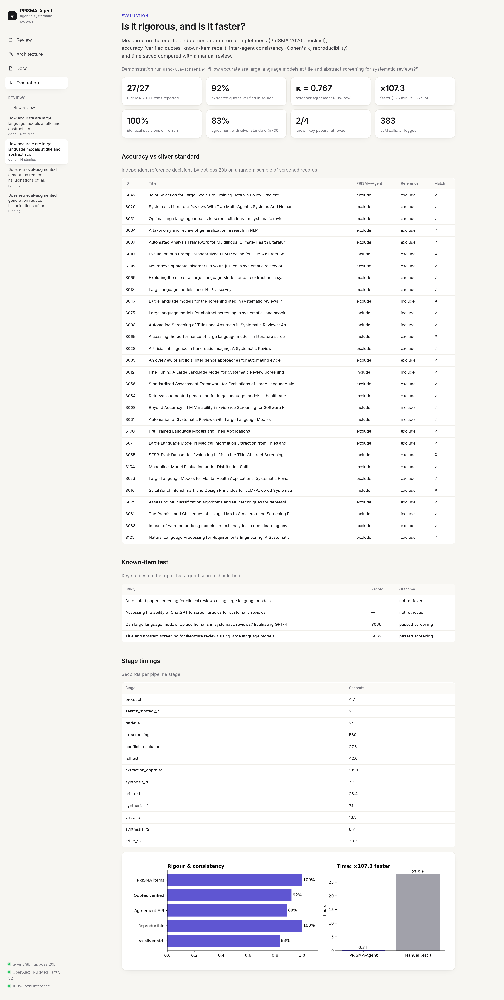 |

Full pages: [Architecture](screenshots/09_architecture.png) · [Docs](screenshots/10_docs.png) · [Overview](screenshots/04_overview.png)

## Project structure

```
M1_final_project/
├── prisma_agent/
│   ├── graph.py          # LangGraph workflow (state, nodes, edges, loops, checkpoints)
│   ├── agents.py         # the agents + coordinator routing + HITL interrupts
│   ├── schemas.py        # Pydantic schemas for every agent output
│   ├── rag.py            # hybrid RAG: FAISS + BM25 + RRF + FlashRank + compression
│   ├── sources/          # OpenAlex, PubMed, arXiv, Semantic Scholar clients (cached)
│   ├── dedup.py          # DOI + fuzzy-title deduplication
│   ├── report.py         # PRISMA diagram, figures, manuscript (MD/DOCX), BibTeX, checklist, manifest
│   ├── trace.py          # audit trail + LLM call tracer
│   ├── llm.py · config.py
│   ├── server.py         # FastAPI + SSE web app
│   ├── cli.py            # Typer CLI (run / replay / show)
│   ├── mcp_server.py     # MCP server
│   └── static/           # UI (HTML/CSS/JS, rough.js hand-drawn diagrams)
├── runs/demo-llm-screening/   # complete demonstration review (all artefacts)
├── scripts/              # evaluate.py
├── tests/                # pytest
├── paper/                # the systematic literature review (LaTeX + PDF, ICICIC format)
├── docs/                 # ARCHITECTURE, USER_GUIDE, EVALUATION, technical report
└── presentation/         # slides (PDF/PPTX), final video, demo.mp4
```

## Development steps

1. **Requirements analysis.** I mapped the brief and the PRISMA 2020 statement (27 items, flow diagram) to pipeline stages and agents.
2. **Data layer.** I wrote clients for OpenAlex (abstract reconstruction from the inverted index), PubMed E-utilities (XML), arXiv (Atom) and Semantic Scholar, with an on-disk cache, rate limits and retries, followed by DOI + fuzzy-title deduplication.
3. **Agent contracts.** I defined Pydantic schemas for every agent output and used JSON-schema constrained decoding with self-correcting retries.
4. **Workflow.** I built the LangGraph `StateGraph` with coordinator routing, the search-broadening loop, dual screening and conflict resolution, the critic revision loop, `interrupt()` human checkpoints, `RetryPolicy` and SQLite checkpoints.
5. **RAG.** I added PDF retrieval and parsing, chunking with provenance, hybrid FAISS + BM25 retrieval, RRF, FlashRank re-ranking and compression, plus automatic verification of the extracted quotes.
6. **Reporting.** I wrote the PRISMA flow diagram, figures, a manuscript covering all 27 PRISMA items, DOCX, BibTeX, CSVs, the checklist validator and the reproducibility manifest.
7. **Interfaces.** I built the CLI (run / replay / show), the FastAPI + SSE web app (live stepper, audit trail, HITL panels, results, architecture, docs, evaluation) and the MCP server.
8. **Testing and evaluation.** I wrote unit tests, a pilot run, the full demonstration run and the evaluation script: silver standard, known items, κ, reproducibility and time.
9. **Hardening from the observations.** Each fix came from something observed in a run:
   - aligned screener instructions (κ went from 0.14 to 0.90);
   - linear-time quote verification;
   - repairs of small-model output slips;
   - a deterministic overall RoB rule;
   - the time-travel replay.
10. **Documentation and communication.** I produced the hand-drawn diagrams, README, user guide, technical report, slides, video script and demo video.

## Team and individual contribution

Team: **1 member, HADDADmed (Mohammed Haddad)**, responsible for the whole project: design, implementation of every agent and of the RAG pipeline, web app, evaluation, documentation, presentation and video.

## Video and presentation

- **🎬 Final video (2 min 56 s, silent with on-screen captions):** [presentation/PRISMA-Agent_final_video.mp4](presentation/PRISMA-Agent_final_video.mp4): the slides plus a live demo
- **Demo only (1 min 50 s):** [presentation/demo.mp4](presentation/demo.mp4). It shows typing a question, checkpoint 1 (protocol approval), live dual screening, checkpoint 2 (conflicts), the agents finishing, then the full results, architecture and evaluation
- **Slides:** [presentation/slides.pdf](presentation/slides.pdf) · [slides.pptx](presentation/slides.pptx) (script in the speaker notes)

---

<sub>Built with LangGraph, LangChain Core, Ollama (qwen3:8b, gpt-oss:20b, nomic-embed-text), FAISS, rank-bm25, FlashRank, PyMuPDF, RapidFuzz, FastAPI, MCP, matplotlib, python-docx, rough.js and Playwright.</sub>
