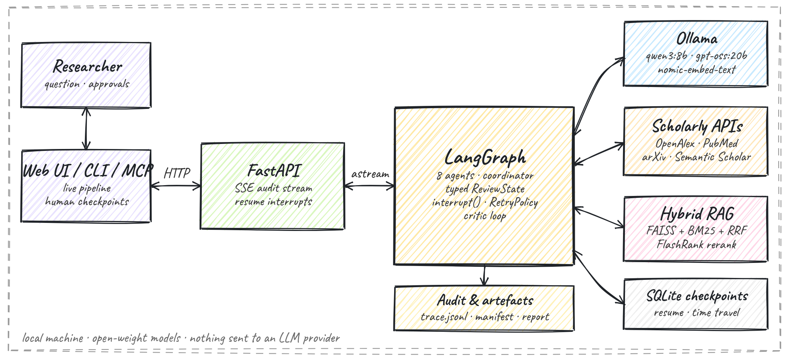
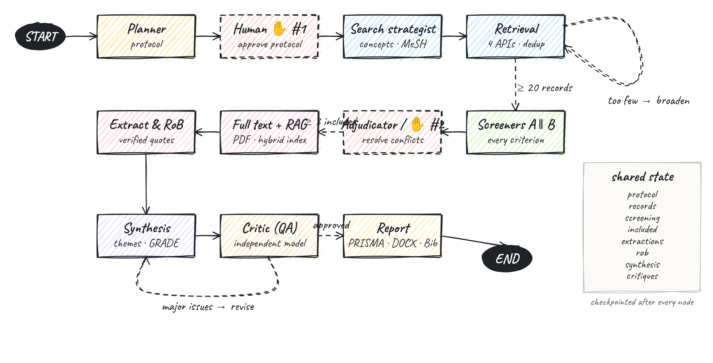
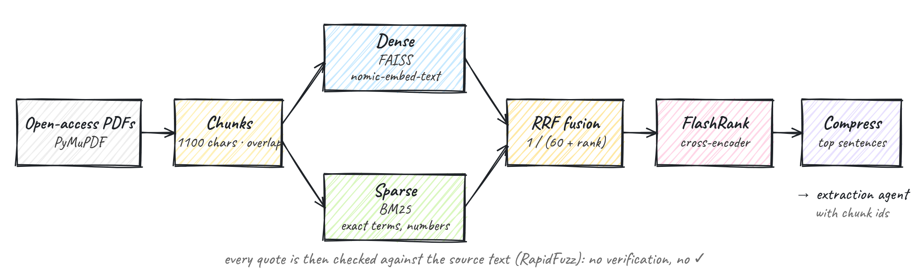

# Architecture

PRISMA-Agent turns a research question into a PRISMA 2020 systematic review with a **multi-agent LangGraph workflow**. This document explains the components, the workflow, the shared state and the design decisions.

## 1. Components

| Layer | Component | File |
|---|---|---|
| Interfaces | Web app (FastAPI + SSE + vanilla JS), CLI (Typer + Rich), MCP server (FastMCP) | `server.py`, `cli.py`, `mcp_server.py` |
| Orchestration | LangGraph `StateGraph`, coordinator routing, `interrupt()` checkpoints, `RetryPolicy`, SQLite checkpointer | `graph.py`, `agents.py` |
| Agents | Planner, search strategist, retrieval, screeners A/B, adjudicator, full-text screener, extractor/appraiser, writer, critic | `agents.py` |
| Models | Ollama: `qwen3:8b` (worker), `gpt-oss:20b` (judge), `nomic-embed-text` (embeddings) | `llm.py`, `config.py` |
| Knowledge | OpenAlex, PubMed E-utilities, arXiv, Semantic Scholar; cached HTTP | `sources/` |
| RAG | PyMuPDF parsing → chunks → FAISS + BM25 → RRF → FlashRank → compression | `rag.py` |
| Outputs | PRISMA flow diagram, RoB traffic light, evidence map, results plot, Markdown/DOCX manuscript, BibTeX, CSV, checklist, manifest | `report.py` |
| Audit | Append-only `trace.jsonl` + LLM callback tracer | `trace.py` |

## 2. Workflow

| # | Node | Agent | What it does | Output in state |
|---|---|---|---|---|
| 1 | `planner` | Planner | Writes the protocol: PICO/PCC/SPIDER, numbered criteria (I1…, E1…), RoB domains, synthesis plan | `protocol` |
| 2 | `protocol_review` | Human ✋ #1 | `interrupt()`: the human approves or edits the criteria (in `auto` mode the approval is logged) | `protocol_approved_by` |
| 3 | `search_strategist` | Search strategist | Concept blocks + synonyms + MeSH; a **deterministic compiler** writes PubMed / arXiv / generic Boolean syntax | `strategy` |
| 4 | `retrieval` | Retrieval | Parallel search of 4 databases (rate-limited, cached), DOI + fuzzy-title deduplication | `records`, `search_log`, `identified` |
| ◆ | coordinator | Coordinator | `< 20` unique records → `broaden` → new search round (max 2) | routing + logged reason |
| 5 | `screening` | Screeners A and B | Independent decisions with a yes/no/unclear check per criterion and a rationale; Cohen's κ | `screening`, `kappa` |
| 6 | `conflict_resolution` | Adjudicator / Human ✋ #2 | Disagreements resolved by `gpt-oss:20b` or by the human (`interrupt()`) | `ta_included` |
| ◆ | coordinator | Coordinator | `< 3` included → broaden the search | |
| 7 | `fulltext` | Retrieval + full-text screener | Downloads open-access PDFs, builds the hybrid index, judges eligibility on retrieved passages with exclusion codes | `fulltext`, `included` |
| 8 | `extraction` | Extractor + appraiser | Structured extraction with verbatim quotes + chunk ids (verified), then risk of bias per protocol domain | `extractions`, `rob`, `grounding` |
| 9 | `synthesis` | Writer | Themes, GRADE-style certainty, meta-analysis feasibility, gaps; only from the evidence table | `synthesis` |
| 10 | `critic` | Critic | Deterministic checks (citations exist, coverage) + independent LLM review → `revise` (max 2 rounds) or `report` | `critiques` |
| 11 | `report` | Reporter | All artefacts + PRISMA checklist + manifest | `report_dir`, `metrics` |

## 3. Shared state

`ReviewState` (a `TypedDict`) is the single source of truth: protocol, strategy, search log, records, screening rows (A, B, final, decided-by, rationales), included ids, full-text decisions, extractions, risk of bias, synthesis, critiques, timings and metrics. It is **checkpointed in SQLite after every node** (`AsyncSqliteSaver`), which gives:

- **pause / resume**: human-in-the-loop interrupts can wait for hours;
- **crash recovery**: a failed node is retried (`RetryPolicy`) or the run is resumed from the last checkpoint;
- **time travel**: every intermediate state can be inspected.

The RAG index and parsed full texts are not serialisable, so they live in a per-run cache outside the state.

## 4. Hybrid RAG

1. Open-access PDFs (OpenAlex `oa_url`, arXiv) are downloaded and parsed with PyMuPDF (first 14 pages, reference list removed).
2. Text is split into ~1,100-character chunks with 200 characters of overlap, cut at sentence boundaries. Each chunk keeps `study` and `chunk` ids (`S012#ft3`).
3. **Dense**: `nomic-embed-text` vectors (with `search_document:` / `search_query:` task prefixes), cosine similarity in FAISS.
4. **Sparse**: Okapi BM25 (exact terms, numbers, acronyms).
5. **Reciprocal Rank Fusion**, score = Σ 1/(60 + rank).
6. **FlashRank** cross-encoder (`ms-marco-MiniLM-L-12-v2`) re-ranks the top 20.
7. **Compression**: only the sentences that share most terms with the query are kept (eligibility). Extraction receives the full passages, so that quotes can be copied verbatim.
8. **Verification**: each quote is searched in the source text (exact match after normalisation, else a sliding-window RapidFuzz ratio ≥ 90).

## 5. Design decisions

| Decision | Why |
|---|---|
| LangGraph instead of a linear chain | Loops (broaden, revise), conditional routing, interrupts and checkpointing are first-class |
| Two model families (worker vs judge) | A model reviewing its own output shares its blind spots; the adjudicator and critic are independent |
| Structured output everywhere (Pydantic + JSON-schema decoding) | Every decision is machine-checkable; invalid output is retried with the validation error |
| Deterministic query compiler | LLMs design concepts well but often get database syntax wrong; the compiler guarantees valid PubMed/arXiv queries |
| Criterion-level screening checks | The rationale is explicit (which criterion failed), not a vague "irrelevant" |
| Local models (Ollama) | Privacy, zero cost, and reproducibility (pinned model digests in the manifest) |
| Cached HTTP | The same search can be replayed exactly; searches are dated in the report |
| Deterministic rules where possible | Overall RoB = worst domain; citation checks; PRISMA counts computed, not generated |

## 6. Observability

Every event goes to `runs/<id>/trace.jsonl`. The event kinds are `stage`, `decision`, `tool`, `llm_call` (model, seconds, tokens), `screening`, `coordinator`, `hitl`, `interrupt` and `error`. The web app replays the file and streams new events through Server-Sent Events. `manifest.json` records the configuration and its fingerprint, the model digests, package versions, timings, PRISMA counts and metrics.
