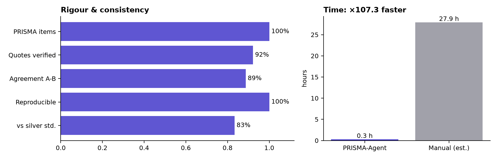

# Evaluation

Run `demo-llm-screening`, question: *How accurate are large language models at title and abstract screening for systematic reviews?*. Evaluated on 2026-11-15; the evaluation itself took 122 s.

| Dimension | Metric | Result |
|---|---|---|
| Completeness | PRISMA 2020 checklist items present in the manuscript | **27/27** |
| Completeness | Pipeline stages completed autonomously | 10/10 |
| Completeness | Extraction fields filled (not "not reported") | 86% |
| Accuracy | Extracted quotes found verbatim in the source text | **92%** |
| Accuracy | Screening vs silver standard (gpt-oss:20b, n=30): accuracy | **83%** |
| Accuracy | … sensitivity / specificity | 86% / 83% (TP 6, FP 4, FN 1, TN 19) |
| Accuracy | Known key papers retrieved / passed screening | 2/4 / 2/4 |
| Consistency | Cohen's κ between screening agents A and B | **0.767** (raw agreement 89%, 13 conflicts adjudicated) |
| Consistency | Reproducibility: identical decisions when re-screening 20 records | **100%** |
| Consistency | Critic rounds / final approval | 3 / True |
| Time | End-to-end pipeline | **15.6 min** (383 LLM calls) |
| Time | Manual estimate for the same workload | ~27.9 h (2 reviewers × (0.5 min per abstract + 10 min per full text + 45 min per extraction/appraisal)) |
| Time | Speed-up | **×107.3** |

## Known-item test

| Study | Record | Outcome |
|---|---|---|
| Automated paper screening for clinical reviews using large language models | — | not retrieved |
| Assessing the ability of ChatGPT to screen articles for systematic reviews | — | not retrieved |
| Can large language models replace humans in systematic reviews? Evaluating GPT-4 | S066 | passed screening |
| Title and abstract screening for literature reviews using large language models: | S082 | passed screening |

## How to read these numbers

- The **silver standard** is an independent model, not a human gold standard. It measures consistency with a stronger, different reviewer, not the absolute truth.
- The **manual estimate** counts reviewer time only (two reviewers), not protocol writing, searching or writing the manuscript, so the real saving is larger.
- **Known-item recall** depends on the search budget (records per query) and on API rate limits (Semantic Scholar often returns HTTP 429 without an API key).
