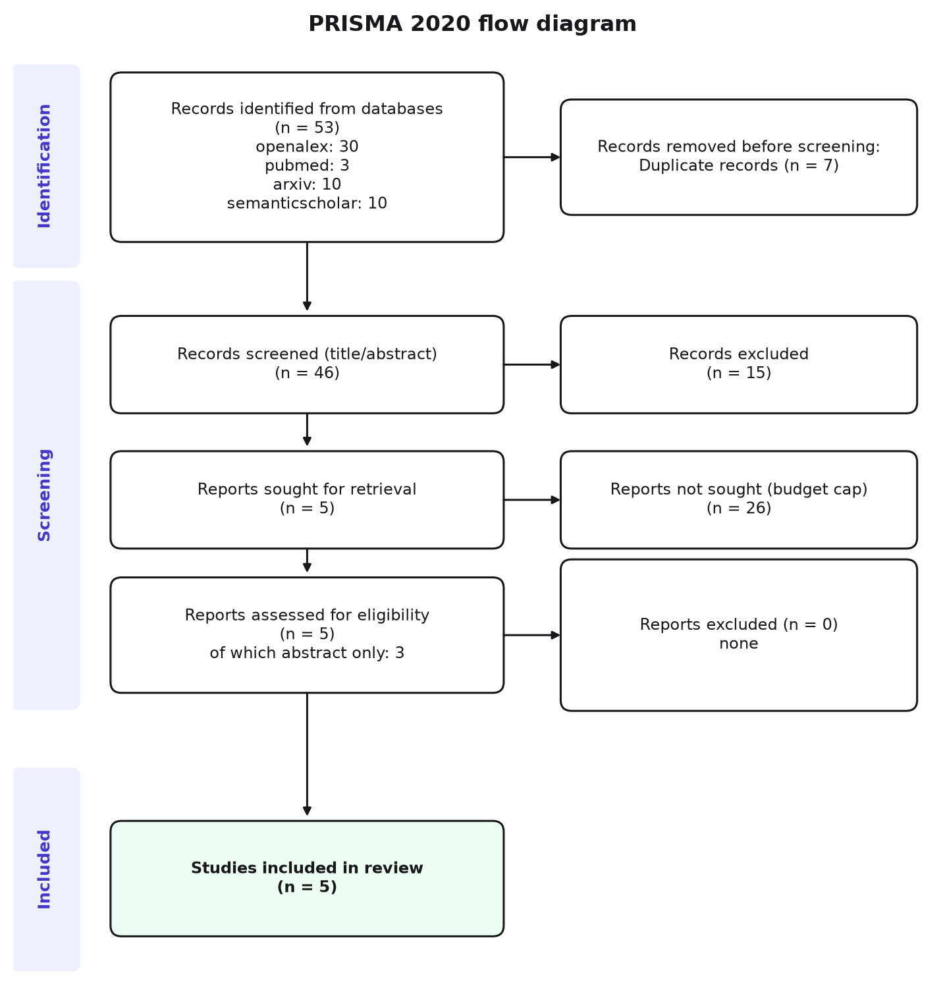
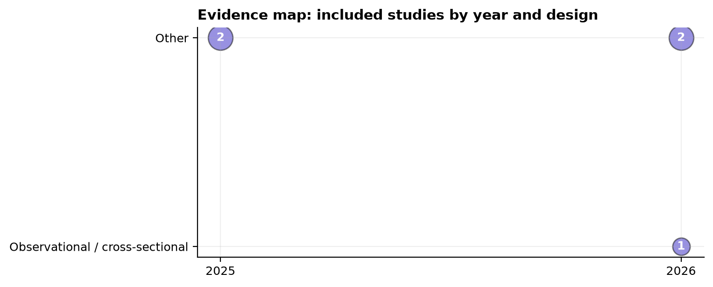
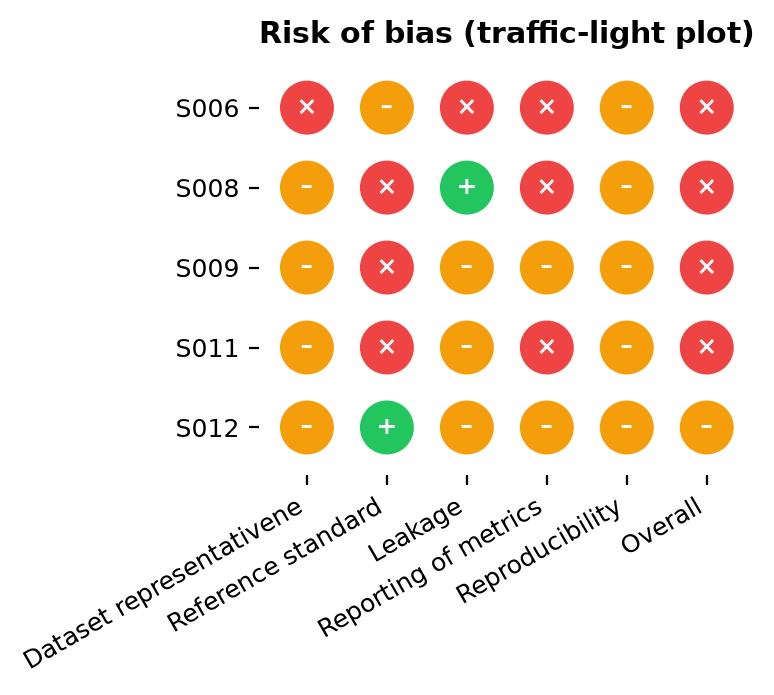
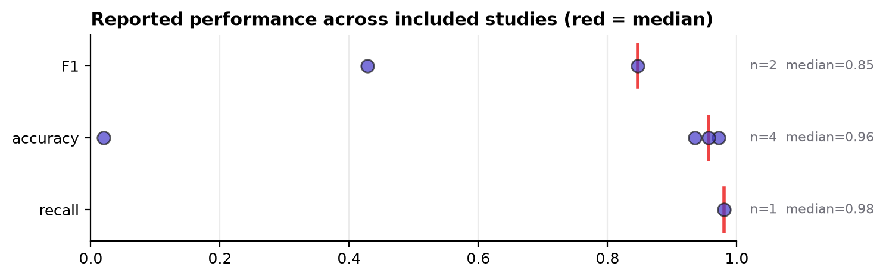

# Retrieval-Augmented Generation for Reducing Hallucinations in Large Language Models: A Systematic Review

*A systematic review generated by PRISMA-Agent, run `20261115-145329-does-retrieval-augmented-generation-redu`, 2026-11-15.*

## Abstract

**Background.** To evaluate the effectiveness of retrieval-augmented generation (RAG) in reducing hallucinations in large language models (LLMs).
**Methods.** We searched openalex, pubmed, arxiv, semanticscholar (2020–2026). Two independent AI reviewers screened 46 records, with disagreements adjudicated by an independent model. Data were extracted with retrieval-augmented generation and verbatim, verified quotes. Risk of bias was assessed across 5 domains, and the evidence was synthesised narratively with GRADE-style certainty ratings.
**Results.** 53 records were identified, 46 screened and 5 assessed in full; 5 studies were included. Inter-reviewer agreement: Cohen's κ = 0.044.
**Conclusion.** Retrieval-augmented generation (RAG) appears to reduce hallucinations of large language models, with the strongest evidence from [S008: Liu et al., 2026], which reports a 15.0-percentage-point absolute reduction in hallucination rates. Other studies ([S006: Zhang et al., 2026], [S011: Wang et al., 2025]) show improved hallucination-related metrics (e.g., F1 score, hallucinated prediction rate) without explicit numeric reductions. [S009: S. et al., 2026] and [S012: Omoush et al., 2025] lack explicit hallucination metrics, instead reporting improvements in accuracy and F-measure. The evidence for hallucination reduction is limited to [S008: Liu et al., 2026] and relative improvements in [S006: Zhang et al., 2026] and [S011: Wang et al., 2025]. Due to high risk of bias, inconsistent metrics, and imprecision, the certainty of these findings is low.

## Introduction

### Rationale
To evaluate the effectiveness of retrieval-augmented generation (RAG) in reducing hallucinations in large language models (LLMs).

### Objectives
Review question: *Does retrieval-augmented generation reduce hallucinations of large language models?*
Framework: PICO. Population: Large language models (LLMs) used in natural language processing tasks. Intervention/concept: Retrieval-augmented generation (RAG), where LLMs are augmented with external knowledge sources during the generation process. Comparator: Standard large language models without retrieval augmentation. Outcomes: Reduction in hallucination rates (e.g., percentage of generated text that is factually incorrect or fabricated)., Improvement in factual accuracy of generated text., Enhanced coherence and relevance of generated responses., User satisfaction or perceived accuracy of generated content.. Context: Applications of LLMs in domains such as customer service, education, healthcare, and information retrieval..

## Methods

### Eligibility criteria
- **I1** Studies that evaluate the impact of retrieval-augmented generation (RAG) on hallucination rates in large language models.
- **I2** Studies that report on hallucination metrics (e.g., factuality, coherence, or alignment with ground truth).
- **I3** Studies that compare RAG-enhanced models with standard LLMs in terms of hallucination reduction.
- **I4** Studies published in peer-reviewed journals, conference proceedings, or grey literature (e.g., technical reports) in English.
- **I5** Studies published from 2020 onwards.
- **E1** Studies that do not report on hallucination rates or related outcomes.
- **E2** Studies that focus on non-LLM systems or do not involve large language models.
- **E3** Studies that do not compare RAG with standard LLMs or other interventions.
- **E4** Studies that are not available in English.
- **E5** Studies that are not peer-reviewed or are not published in the specified timeframe.

Study designs: Randomized controlled trials (RCTs) or quasi-experimental studies, Comparative studies, Experimental studies, Simulation studies, Empirical evaluations. Languages: English.

### Information sources
openalex, pubmed, arxiv, semanticscholar, searched on 2026-11-15 through their public APIs. All responses are cached in `.cache/http/`, so the search can be re-executed identically.

### Search strategy
The search-strategy agent built concept blocks (combined with AND, synonyms with OR), and a compiler turned them into database-specific syntax:

- **openalex** (round 1): `Retrieval-Augmented Generation AND Large Language Models AND hallucination` → 10 records
- **openalex** (round 1): `RAG AND LLM AND factually incorrect generation` → 10 records
- **openalex** (round 1): `External knowledge integration AND AI hallucination AND language models` → 10 records
- **pubmed** (round 1): `("Retrieval-Augmented Generation"[tiab] OR "RAG"[tiab] OR "Retrieval-augmented generation"[tiab] OR "Retrieval enhanced generation"[tiab] OR "External knowledge integration in LLMs"[tiab]) AND ("Large Language Models"[tiab] OR "LLMs"[tiab] OR "Transformer-based language models"[tiab] OR "Pre-trained language models"[tiab] OR "Deep learning language models"[tiab]) AND ("AI hallucination"[tiab] OR "LLM hallucination"[tiab] OR "Factually incorrect generation"[tiab] OR "Fabricated content generation"[tiab] OR "Model hallucination"[tiab])` → 3 records
- **arxiv** (round 1): `(all:"Retrieval-Augmented Generation" OR all:RAG OR all:"Retrieval-augmented generation" OR all:"Retrieval enhanced generation") AND (all:"Large Language Models" OR all:LLMs OR all:"Transformer-based language models" OR all:"Pre-trained language models") AND (all:"AI hallucination" OR all:"LLM hallucination" OR all:"Factually incorrect generation" OR all:"Fabricated content generation")` → 10 records
- **semanticscholar** (round 1): `Retrieval-Augmented Generation AND Large Language Models AND hallucination` → 0 records (error: semanticscholar: request failed after 3 attempts)
- **semanticscholar** (round 1): `RAG AND LLM AND factually incorrect generation` → 10 records

### Selection process
Duplicates were removed by DOI and fuzzy title matching (RapidFuzz ≥ 93). Each record was screened independently by two LLM reviewers (same criteria; different sampling seeds, temperature and order of presentation), which judged every criterion as yes / no / unclear. Records were excluded only on a clear violation of a criterion. 15 disagreements were resolved by an adjudicator (gpt-oss:latest or the human reviewer). Full texts were retrieved from open-access sources, parsed (PyMuPDF), chunked and indexed for hybrid retrieval (FAISS dense + BM25, reciprocal rank fusion, FlashRank re-ranking).

### Data collection process
An extraction agent filled a structured form from the top re-ranked passages of each study. Every value carries a verbatim quote and a chunk id. Quotes were automatically checked against the source text: **100 % verified**.

### Data items
Study design; population or dataset; intervention or method; comparator; outcomes; quantitative results (metric, value, comparator); main finding; limitations.

### Risk of bias assessment
Domains: Dataset representativeness: Whether the training or evaluation datasets are representative of real-world scenarios and relevant to the target application., Reference standard: Whether a clear and valid reference standard (e.g., gold standard dataset, human annotations) is used to assess hallucinations., Leakage: Whether there is any evidence of data leakage between training and testing phases, which could artificially inflate performance., Reporting of metrics: Whether the study reports on hallucination metrics (e.g., factuality, coherence, alignment with ground truth) and provides sufficient detail for reproducibility., Reproducibility: Whether the study provides sufficient detail (e.g., code, data, model architecture) to allow replication of the RAG implementation and evaluation.. Each was judged low / some concerns / high with a justification; the overall judgement is the worst domain.

### Effect measures
As reported by the studies (e.g. F1, accuracy, recall). No conversion was applied.

### Synthesis methods
A meta-analysis will be conducted to synthesize the effect sizes of RAG on hallucination reduction. If heterogeneity is high, subgroup analyses will be performed based on model type, domain of application, and evaluation metrics. Narrative synthesis will also be used to summarize qualitative findings and contextual factors influencing the effectiveness of RAG. Studies were grouped into themes by the synthesis agent. A critic agent (gpt-oss:latest) checked every claim against the evidence table (up to 2 revision rounds).

### Reporting bias
Not formally assessed (too few studies per outcome for funnel-plot methods); preprints were included to limit publication bias.

### Certainty assessment
GRADE-inspired rating per theme (risk of bias, inconsistency, imprecision, indirectness).

## Results

### Study selection
53 records were identified (openalex: 30, pubmed: 3, arxiv: 10, semanticscholar: 10). 7 duplicates were removed, 46 records were screened and 15 excluded. 5 reports were sought and 5 assessed (3 on the abstract only); 0 were excluded (none). **5 studies were included.**

### Study characteristics

| ID | Study | Design | Population / data | Method | RoB |
|---|---|---|---|---|---|
| S006 | Zhang et al., 2026 | not reported | not reported | ISO-RAG (ISOperimetric Retrieval-Augmented Generation) | high |
| S008 | Liu et al., 2026 | Crossover study | 2 pharmacists reviewing 213 outpatient prescriptions | Knowledge-augmented LLM with exact-match injection | high |
| S009 | S. et al., 2026 | Private LLM and RAG Chatbot (2026) | Not reported | Retrieval-Augmented Generation (RAG) system combining a publicly deplo | high |
| S011 | Wang et al., 2025 | Retrieval-Augmented Generation (RAG) framework with graph-based reason | Qwen3-4B-Instruct-2507 LLM on 2080Ti GPU, with low resource setting (- | AGRAG: Advanced Graph-based Retrieval-Augmented Generation with MCMI s | high |
| S012 | Omoush et al., 2025 | Retrieval-Augmented Generation (RAG) integration with Large Language M | Arabic medical question-answering (QA) dataset. | Integration of Retrieval-Augmented Generation (RAG) with Large Languag | some concerns |

### Risk of bias in studies

### Results of individual studies

| ID | Outcome | Metric | Value | Quote verified |
|---|---|---|---|---|
| S006 | reduction_in_hallucination_rates | F1 score | 42.8 | ✓ |
| S006 | improvement_in_factual_accuracy | F1 score | 84.7 | ✓ |
| S006 | enhanced_coherence_and_relevance | R@5 and P@5 | 88.05 and 40.10 | ✓ |
| S006 | user_satisfaction_or_perceived_accuracy | EM score | 80.7 | ✓ |
| S008 | reduction_in_hallucination_rates | Absolute reduction in hallucination rate | 15.0 percentage points | ✓ |
| S008 | improvement_in_factual_accuracy | Accuracy | 97.2% (human-AI collaborative) vs 82.6% (pharmacist-alone) | ✓ |
| S008 | enhanced_coherence_and_relevance | Sensitivity | 98% (human-AI collaborative) vs 55% (pharmacist-alone) | ✓ |
| S009 | reduction_in_hallucination_rates | Reduction in hallucinations | Reported as part of a controlled comparison against three baseline systems, with direct measurement of the reduction in hallucinations on a curated set of 300 queries from an enterprise corpus consisting of 500 documents | ✓ |
| S009 | improvement_in_factual_accuracy | Accuracy | 93.5% | ✓ |
| S011 | reduction_in_hallucination_rates | Hallucinated prediction rate | AGRAG achieves the lowest rate by leveraging MCMI subgraphs to provide explicit evidence for retrieved chunks. | ✓ |
| S011 | improvement_in_factual_accuracy | ACC (Accuracy) | AGRAG-L achieves higher ACC than SiReRAG-L and HippoRAG2-L across multiple tasks. | ✓ |
| S011 | enhanced_coherence_and_relevance | ROG (ROUGE-L) | AGRAG-L achieves higher ROG than SiReRAG-L and HippoRAG2-L across multiple tasks. | ✓ |
| S012 | improvement_in_factual_accuracy | Accuracy | 95.6% (base model) to 97.8% (fine-tuned) to 98.7% (RAG-enhanced) | ✓ |
| S012 | enhanced_coherence_and_relevance | F-measure | 90.4% (base model) to 93.7% (fine-tuned) to 97.6% (RAG-enhanced) | ✓ |

### Results of syntheses
**Reduction in hallucination rates** (certainty: low). Several studies report improvements in hallucination-related metrics, though none provide explicit numeric reductions in hallucination rates. [S006: Zhang et al., 2026] shows an F1 score of 42.8 for hallucination reduction, and [S011: Wang et al., 2025] reports a lower hallucinated prediction rate compared to baselines. [S008: Liu et al., 2026] provides a 15.0-percentage-point absolute reduction in hallucination rates. However, [S009: S. et al., 2026] and [S012: Omoush et al., 2025] do not report hallucination-specific metrics, relying instead on accuracy and F-measure improvements. *Certainty rationale:* High risk of bias (RoB: high in S006, S008, S011; RoB: some concerns in S012), inconsistency in metrics (some studies report relative improvements, others lack explicit hallucination metrics), and imprecision (no numeric reduction in hallucination rates for most studies).

**Improvement in factual accuracy** (certainty: low). Multiple studies demonstrate significant improvements in factual accuracy through RAG integration. [S008: Liu et al., 2026] reports a 97.2% accuracy in human-AI collaboration versus 82.6% for pharmacists alone. [S009: S. et al., 2026] achieves 93.5% accuracy in business knowledge retrieval. [S012: Omoush et al., 2025] shows accuracy increasing from 95.6% (base model) to 98.7% (RAG-enhanced). [S011: Wang et al., 2025] reports higher ACC (Accuracy) for AGRAG-L compared to SiReRAG-L and HippoRAG2-L. *Certainty rationale:* High risk of bias (RoB: high in S008, S009, S011; RoB: some concerns in S012), inconsistency in metrics (some studies use different accuracy benchmarks), and imprecision (no standardization of accuracy measurement across studies).

**Enhanced coherence and relevance** (certainty: low). RAG is associated with improved coherence and relevance of generated responses. [S006: Zhang et al., 2026] reports enhanced coherence and relevance with R@5=88.05 and P@5=40.10. [S008: Liu et al., 2026] shows improved sensitivity (98% vs 55%) in pharmacist-led prescription review. [S011: Wang et al., 2025] reports higher ROG (ROUGE-L) scores for AGRAG-L compared to SiReRAG-L and HippoRAG2-L. [S012: Omoush et al., 2025] reports enhanced coherence and relevance through improved F-measure (97.6% for RAG-enhanced). *Certainty rationale:* High risk of bias (RoB: high in S006, S008, S011; RoB: some concerns in S012), inconsistency in metrics (different coherence and relevance benchmarks), and imprecision (no standardization of measurement across studies).

**User satisfaction and perceived accuracy** (certainty: very low). Some studies report improved user satisfaction or perceived accuracy through RAG integration. [S006: Zhang et al., 2026] reports an EM score of 80.7 for user satisfaction or perceived accuracy. [S012: Omoush et al., 2025] shows improved perceived accuracy through higher F-measure and accuracy scores. *Certainty rationale:* High risk of bias (RoB: high in S006; RoB: some concerns in S012), inconsistency in metrics (no standardized user satisfaction or perceived accuracy measurement), and imprecision (no direct measurement of user satisfaction).

**Meta-analysis.** Not feasible: A meta-analysis is not feasible due to the lack of a common outcome metric for hallucination reduction. Only S008 provides a numeric reduction in hallucination rates, while other studies report relative improvements or accuracy/F-measure gains. The heterogeneity in metrics and study designs further limits the ability to pool effect sizes across studies.

## Discussion

**Main answer.** Retrieval-augmented generation (RAG) appears to reduce hallucinations of large language models, with the strongest evidence from [S008: Liu et al., 2026], which reports a 15.0-percentage-point absolute reduction in hallucination rates. Other studies ([S006: Zhang et al., 2026], [S011: Wang et al., 2025]) show improved hallucination-related metrics (e.g., F1 score, hallucinated prediction rate) without explicit numeric reductions. [S009: S. et al., 2026] and [S012: Omoush et al., 2025] lack explicit hallucination metrics, instead reporting improvements in accuracy and F-measure. The evidence for hallucination reduction is limited to [S008: Liu et al., 2026] and relative improvements in [S006: Zhang et al., 2026] and [S011: Wang et al., 2025]. Due to high risk of bias, inconsistent metrics, and imprecision, the certainty of these findings is low.

**Research gaps.**
- Lack of standardized hallucination metrics across studies
- Limited direct measurement of hallucination rates in most studies
- Need for more diverse domains and larger sample sizes to improve generalizability
- Insufficient exploration of RAG effectiveness in low-resource or non-English settings

**Limitations of the evidence.** Certainty and the risk of bias per theme are given above, and reporting bias cannot be excluded.

**Limitations of the review process.** This review was conducted by an autonomous multi-agent system using local open-weight LLMs (screening, extraction and appraisal by qwen3:8b, adjudication and critique by gpt-oss:latest). Decisions are traceable but were not verified by two human reviewers. 3 reports were assessed on the abstract only because no open-access full text was found, and 26 records were not sought because of the full-text budget cap.

**Quality assurance.** The critic agent ran 2 round(s); final verdict: approved. Remaining issues: 1.
- [minor] Theme 1 – Reduction in hallucination rates: The synthesis states that "S009 and S012 lack explicit hallucination metrics," whereas the evidence table indicates that S009 does report a reduction in hallucinations (though no numeric value is provided). This is a minor inaccuracy in wording.

## Other information

### Registration and protocol
Not registered. The protocol generated by the planner agent (approved by: human) is saved as `protocol.json`.

### Support
No funding.

### Competing interests
None.

### Availability of data, code and other materials
All artefacts are in this run folder: `protocol.json`, `screening_log.csv`, `evidence_table.csv`, `extractions.json`, `trace.jsonl` (full audit trail), `manifest.json` (models, versions, configuration fingerprint) and `references.bib`.

## References
1. [S006] Siyuan Zhang, Hanchen Wang, Dong Wen et al. (2026). ISO-RAG: Isoperimetric Noise Control for Retrieval-Augmented Generation. *arXiv*. https://arxiv.org/abs/2609.00513v1
2. [S008] Zhengyue Liu, Yi Ding, Jingxia Chen et al. (2026). Locally Deployed Large Language Models for AI-Assisted Outpatient Prescription Review: Crossover Study.. *JMIR medical informatics*. https://doi.org/10.2196/97520
3. [S009] Bhoomika S. S., A. S, Amith B. N. et al. (2026). Private LLM and RAG Chatbot. *2026 2nd International Conference on Ambient Intelligence, Knowledge Informatics and Industrial Electronics (AIKIIE)*. https://doi.org/10.1109/aikiie69997.2026.11708454
4. [S011] Yubo Wang, Haoyang Li, Fei Teng et al. (2025). AGRAG: Advanced Graph-based Retrieval-Augmented Generation for LLMs. *arXiv*. https://arxiv.org/abs/2511.05549v2
5. [S012] Ebtehal H. Omoush, Rawan Ghnemat (2025). Advancing Arabic Medical Question Answering Systems with RAG and LLMs Integration. *Italian Conference on Theoretical Computer Science*. https://doi.org/10.1109/ictcs65341.2025.10989446
