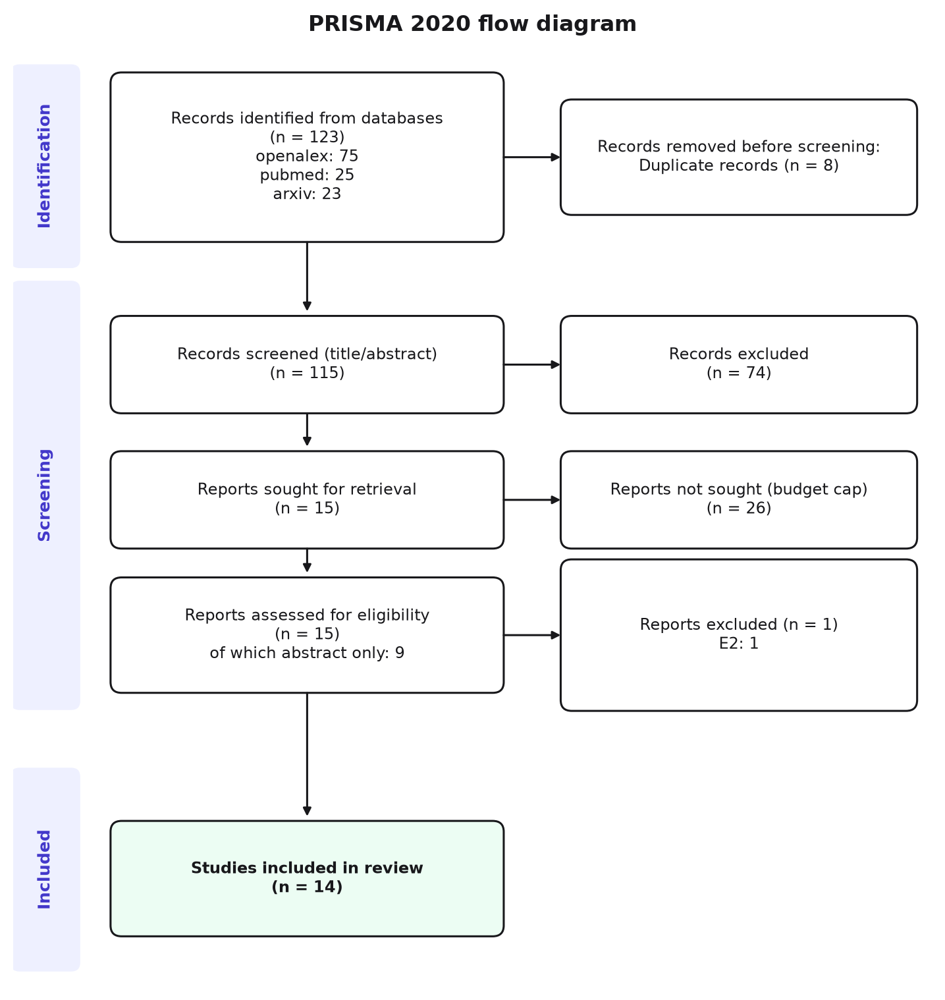
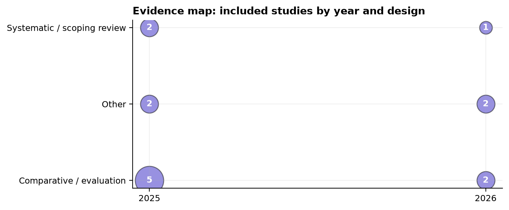
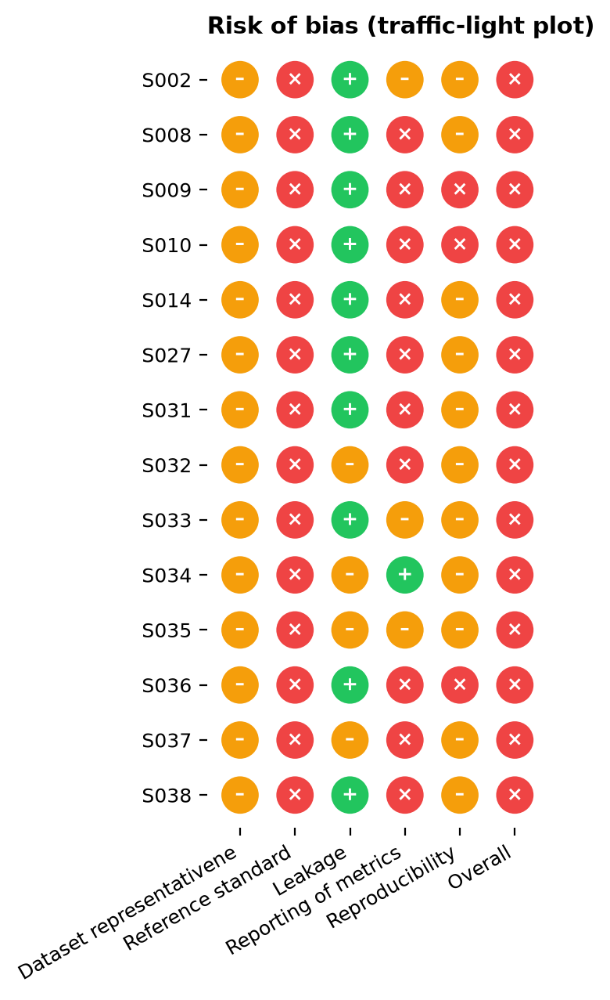
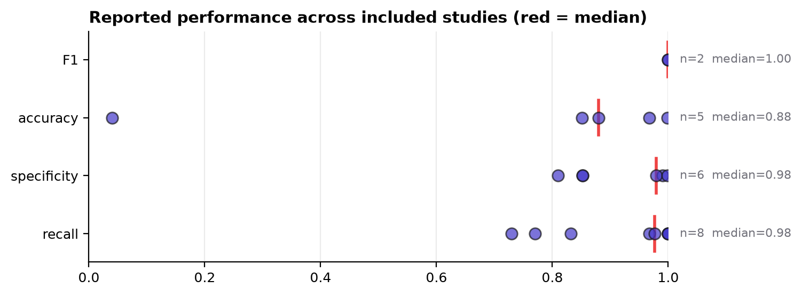

# Large Language Models for Title and Abstract Screening in Systematic Reviews: A Systematic Review

*A systematic review generated by PRISMA-Agent, run `demo-llm-screening`, 2026-11-15.*

## Abstract

**Background.** To evaluate the accuracy of large language models (LLMs) in performing title and abstract screening for systematic reviews.
**Methods.** We searched openalex, pubmed, arxiv, semanticscholar (2020–2026). Two independent AI reviewers screened 115 records, with disagreements adjudicated by an independent model. Data were extracted with retrieval-augmented generation and verbatim, verified quotes. Risk of bias was assessed across 5 domains, and the evidence was synthesised narratively with GRADE-style certainty ratings.
**Results.** 123 records were identified, 115 screened and 15 assessed in full; 14 studies were included. Inter-reviewer agreement: Cohen's κ = 0.767.
**Conclusion.** Large language models (LLMs) demonstrate high sensitivity in title and abstract screening for systematic reviews, with some studies reporting perfect sensitivity (100%) [S037: Kim et al., 2025], while specificity varies more widely, ranging from 81% [S037: Kim et al., 2025] to 99.9% [S034: Vallamchetla et al., 2025]. Overall accuracy ranges from 85.1% [S008: Fazeli et al., 2026] to 99.9% [S034: Vallamchetla et al., 2025]. However, the trade-off between sensitivity and specificity is a key consideration, as some models prioritize sensitivity at the expense of specificity. Time efficiency is also notable, with some studies reporting a 75% reduction in screening workload [S034: Vallamchetla et al., 2025] and others noting that LLMs can complete screening in under 1 day for a fraction of the cost of human screening [S033: Cao et al., 2025]. While LLMs show strong inter-rater agreement with human reviewers in some cases [S034: Vallamchetla et al., 2025], variability in performance across domains and prompting strategies suggests that further refinement is needed for consistent and reliable use.

## Introduction

### Rationale
To evaluate the accuracy of large language models (LLMs) in performing title and abstract screening for systematic reviews.

### Objectives
Review question: *How accurate are large language models at title and abstract screening for systematic reviews?*
Framework: PICO. Population: Large language models (LLMs) used for screening titles and abstracts in systematic reviews. Intervention/concept: Application of LLMs for title and abstract screening in systematic reviews. Comparator: Traditional screening methods (e.g., manual screening by reviewers, rule-based screening tools). Outcomes: Sensitivity of LLMs in identifying relevant studies., Specificity of LLMs in excluding irrelevant studies., Overall accuracy of LLMs in title and abstract screening., Inter-rater agreement between LLMs and human reviewers., Time efficiency of LLMs compared to traditional methods.. Context: Systematic reviews in health and social sciences where LLMs are used for title and abstract screening..

## Methods

### Eligibility criteria
- **I1** Studies that evaluate the performance of large language models (LLMs) in title and abstract screening for systematic reviews.
- **I2** Studies that report sensitivity, specificity, or overall accuracy metrics for LLMs in screening tasks.
- **I3** Studies that compare LLMs with traditional screening methods (e.g., manual screening, rule-based tools).
- **I4** Studies published in peer-reviewed journals, conference proceedings, or grey literature in English.
- **I5** Studies published from 2020 onwards.
- **E1** Studies that do not use LLMs for title and abstract screening (e.g., studies using only rule-based or manual screening).
- **E2** Studies that focus on full-text screening or data extraction rather than title and abstract screening.
- **E3** Studies that do not report performance metrics (e.g., sensitivity, specificity, accuracy) for LLMs.
- **E4** Studies that are not available in English.
- **E5** Studies that are not peer-reviewed or are not published in the specified timeframe (2020 onwards).

Study designs: Randomized controlled trials (RCTs) comparing LLMs with traditional methods., Quasi-experimental studies evaluating LLM performance., Observational studies reporting LLM performance metrics., Simulation studies or computational models evaluating LLM accuracy.. Languages: English.

### Information sources
openalex, pubmed, arxiv, semanticscholar, searched on 2026-11-15 through their public APIs. All responses are cached in `.cache/http/`, so the search can be re-executed identically.

### Search strategy
The search-strategy agent built concept blocks (combined with AND, synonyms with OR), and a compiler turned them into database-specific syntax:

- **openalex** (round 1): `Large Language Models AND systematic review screening` → 25 records
- **openalex** (round 1): `LLMs AND title abstract screening accuracy` → 25 records
- **openalex** (round 1): `NLP models AND study selection performance` → 25 records
- **pubmed** (round 1): `("Large Language Models"[tiab] OR "LLMs"[tiab] OR "Transformer-based models"[tiab] OR "Deep learning models"[tiab] OR "Natural Language Processing (NLP) models"[tiab] OR "Pre-trained language models"[tiab]) AND ("Systematic review screening"[tiab] OR "Title and abstract screening"[tiab] OR "Study selection"[tiab] OR "Literature screening"[tiab] OR "Study inclusion/exclusion"[tiab] OR "Systematic review process"[tiab]) AND ("Accuracy"[tiab] OR "Sensitivity"[tiab] OR "Specificity"[tiab] OR "Precision"[tiab] OR "Recall"[tiab] OR "F1 score"[tiab])` → 25 records
- **arxiv** (round 1): `(all:"Large Language Models" OR all:LLMs OR all:"Transformer-based models" OR all:"Deep learning models") AND (all:"Systematic review screening" OR all:"Title and abstract screening" OR all:"Study selection" OR all:"Literature screening") AND (all:Accuracy OR all:Sensitivity OR all:Specificity OR all:Precision)` → 23 records
- **semanticscholar** (round 1): `Large Language Models AND systematic review screening` → 0 records (error: semanticscholar: request failed after 3 attempts)
- **semanticscholar** (round 1): `LLMs AND title abstract screening accuracy` → 0 records (error: semanticscholar: request failed after 3 attempts)

### Selection process
Duplicates were removed by DOI and fuzzy title matching (RapidFuzz ≥ 93). Each record was screened independently by two LLM reviewers (same criteria; different sampling seeds, temperature and order of presentation), which judged every criterion as yes / no / unclear. Records were excluded only on a clear violation of a criterion. 13 disagreements were resolved by an adjudicator (gpt-oss:latest). Full texts were retrieved from open-access sources, parsed (PyMuPDF), chunked and indexed for hybrid retrieval (FAISS dense + BM25, reciprocal rank fusion, FlashRank re-ranking).

### Data collection process
An extraction agent filled a structured form from the top re-ranked passages of each study. Every value carries a verbatim quote and a chunk id. Quotes were automatically checked against the source text: **92 % verified**.

### Data items
Study design; population or dataset; intervention or method; comparator; outcomes; quantitative results (metric, value, comparator); main finding; limitations.

### Risk of bias assessment
Domains: Dataset representativeness: Whether the training and test datasets are representative of the target population of systematic reviews., Reference standard: Whether a gold standard (e.g., expert review) is used to assess LLM performance., Leakage: Whether there is any data leakage between training and testing phases., Reporting of metrics: Whether the study reports sensitivity, specificity, accuracy, and inter-rater agreement., Reproducibility: Whether the study provides sufficient detail to reproduce the LLM screening process.. Each was judged low / some concerns / high with a justification; the overall judgement is the worst domain.

### Effect measures
As reported by the studies (e.g. F1, accuracy, recall, specificity). No conversion was applied.

### Synthesis methods
A meta-analysis will be conducted to pool sensitivity, specificity, and accuracy metrics across studies. Subgroup analyses will be performed based on study design, LLM type, and screening context. Risk-of-bias assessments will be conducted using the Cochrane Risk of Bias 2 tool for RCTs and a modified version for other study designs. Narrative synthesis will be used to summarize findings on the accuracy and utility of LLMs in title and abstract screening for systematic reviews. Studies were grouped into themes by the synthesis agent. A critic agent (gpt-oss:latest) checked every claim against the evidence table (up to 4 revision rounds).

### Reporting bias
Not formally assessed (too few studies per outcome for funnel-plot methods); preprints were included to limit publication bias.

### Certainty assessment
GRADE-inspired rating per theme (risk of bias, inconsistency, imprecision, indirectness).

## Results

### Study selection
123 records were identified (openalex: 75, pubmed: 25, arxiv: 23). 8 duplicates were removed, 115 records were screened and 74 excluded. 15 reports were sought and 15 assessed (9 on the abstract only); 1 were excluded (E2: 1). **14 studies were included.**

### Study characteristics

| ID | Study | Design | Population / data | Method | RoB |
|---|---|---|---|---|---|
| S002 | Li et al., 2026 | AI-assisted literature screening: A hybrid approach using large langua | A corpus of 6331 biomedical articles, focusing on identifying literatu | A hybrid approach combining rule-based preprocessing with DeepSeek R1  | high |
| S008 | Fazeli et al., 2026 | Results The model screened a total of 15,605 records. It included a hi | The model was evaluated using five published systematic reviews across | Methods Model Development A team of scientists and experts in SLR meth | high |
| S009 | Hida et al., 2026 | Objective: To assess LLM performance and variability in screening, qua | We used the same records and reference labels as Felizardo et al. [202 | The experimental execution step consisted of 5 successive iterations o | high |
| S010 | Mosaed et al., 2026 | Evaluation of a Prompt-Standardized LLM Pipeline for Title–Abstract Sc | We performed a retrospective replay of Gemini 2.5 Pro against adjudica | For each corpus we computed confusion matrices and standard metrics (s | high |
| S014 | Laignelot et al., 2026 | Systematic review | Studies that tested LLMs in the different steps of systematic reviews | Assessment of LLMs performance in systematic review tasks | high |
| S027 | Dai et al., 2025 | Diagnostic study comparing the accuracy of LLM-assisted screening vers | 6 thoracic surgery meta-analyses | LLM-assisted screening using ChatGPT-4o (OpenAI), Claude-3.5 (Anthropi | high |
| S031 | Cao et al., 2025 | not reported | the SeroTracker dataset32 for reviews of prevalence (calibration set a | LLM-based screening system adapted from ScreenPrompt approach6. Our LL | high |
| S032 | Homiar et al., 2025 | Development and evaluation of prompts for a large language model to sc | LSR on prodopaminergic interventions for anhedonia | LLM (GPT-4o) in title and abstract screening | high |
| S033 | Cao et al., 2025 | Diagnostic test accuracy | 48 425 citations for abstract screening across 10 SRs; 12 690 freely a | LLM-driven abstract and full-text screening using prompt templates | high |
| S034 | Vallamchetla et al., 2025 | Study: Do it faster with PICOS: Generative AI-Assisted systematic revi | 1,003 articles | LLM-generated structured PICOS summaries | high |
| S035 | Dogra et al., 2025 | Evaluating Large Language Models for Radiology Systematic Review Title | two imaging-focused systematic reviews (n = 5438 and n = 267 abstracts | binary and ternary classification tasks, confidence scoring, and recla | high |
| S036 | Han et al., 2025 | The study evaluates prompting strategies and large language models (LL | The dataset includes 1,376 unique studies manually screened for eligib | The study evaluates six state-of-the-art LLMs (GPT-4o, GPT-4o-Mini, De | high |
| S037 | Kim et al., 2025 | Systematic review and meta-analysis with development of a new tool | Studies reporting performance metrics (sensitivity, specificity, preci | LLM-based models for title and abstract screening | high |
| S038 | Vivekanantha et al., 2025 | Evaluating the Efficacy and Efficiency of GPT-5 for Automated Title an | Three review topics within different subspecialties in orthopedics. | Automated title and abstract screening using GPT-5. | high |

### Risk of bias in studies

### Results of individual studies

| ID | Outcome | Metric | Value | Quote verified |
|---|---|---|---|---|
| S002 | Sensitivity of LLMs in identifying relev | Recall (sensitivity) | 0.77 | ✓ |
| S002 | Overall accuracy of LLMs in title and ab | Accuracy | 0.88 | ✓ |
| S002 | Time efficiency of LLMs compared to trad | Time efficiency | LLMs offer the potential to automate the screening process, which is time-consuming and difficult to scale with traditional methods. | ✓ |
| S008 | Sensitivity of LLMs in identifying relev | Sensitivity | 83.2% | ✓ |
| S008 | Specificity of LLMs in excluding irrelev | Specificity | 85.2% | ✓ |
| S008 | Overall accuracy of LLMs in title and ab | Accuracy | 85.1% | ✓ |
| S008 | Time efficiency of LLMs compared to trad | Time efficiency | see quote | ✓ |
| S009 | Overall accuracy of LLMs in title and ab | S009#ft26 | see quote | ✓ |
| S010 | Sensitivity of LLMs in identifying relev | Baseline performance varied by domain (high recall in broad clinical/diagnostic tasks; poor recall in a tightly scoped preclinical task; moderate under extreme class imbalance). The pre-specified optimization substantially increased recall where needed (e.g., near-ceiling recall for dengue diagnostics; large recall gain for the preclinical burns task) while trading specificity in predictable ways. | Baseline performance varied by domain (high recall in broad clinical/diagnostic tasks; poor recall in a tightly scoped preclinical task; moderate under extreme class imbalance). The pre-specified optimization substantially increased recall where needed (e.g., near-ceiling recall for dengue diagnostics; large recall gain for the preclinical burns task) while trading specificity in predictable ways. | ✓ |
| S010 | Specificity of LLMs in excluding irrelev | The pre-specified optimization substantially increased recall where needed (e.g., near-ceiling recall for dengue diagnostics; large recall gain for the preclinical burns task) while trading specificity in predictable ways. | The pre-specified optimization substantially increased recall where needed (e.g., near-ceiling recall for dengue diagnostics; large recall gain for the preclinical burns task) while trading specificity in predictable ways. | ✓ |
| S010 | Overall accuracy of LLMs in title and ab | For each corpus we computed confusion matrices and standard metrics (sensitivity, specificity, PPV, NPV, accuracy), and conducted a cross-domain error taxonomy of false positives/negatives. | For each corpus we computed confusion matrices and standard metrics (sensitivity, specificity, PPV, NPV, accuracy), and conducted a cross-domain error taxonomy of false positives/negatives. | ✓ |
| S014 | Sensitivity of LLMs in identifying relev | Positive Percent Agreement (PPA) | 0.92 (IQR 0.69-0.98) | ✓ |
| S014 | Specificity of LLMs in excluding irrelev | Negative Percent Agreement (NPA) | 0.89 (0.72-0.95) | ✓ |
| S014 | Overall accuracy of LLMs in title and ab | Positive Percent Agreement (PPA) and Negative Percent Agreement (NPA) | PPA: 0.92 (IQR 0.69-0.98), NPA: 0.89 (0.72-0.95) | ✓ |
| S014 | Inter-rater agreement between LLMs and h | Positive Percent Agreement (PPA) and Negative Percent Agreement (NPA) | PPA: 0.92 (IQR 0.69-0.98), NPA: 0.89 (0.72-0.95) | ✓ |
| S027 | sensitivity_of_llms_in_identifying_relev | pooled sensitivity | 0.73 (95% CI 0.57-0.85) | ✓ |
| S027 | specificity_of_llms_in_excluding_irrelev | pooled specificity | 0.99 (95% CI 0.97-0.99) | ✓ |
| S027 | overall_accuracy_of_llms_in_title_and_ab | area under the curve (AUC) | 0.97 (95% CI 0.96-0.99) | ✓ |
| S031 | Sensitivity of LLMs in identifying relev | Sensitivity | 96.7% (phase 1 article screening) | ✓ |
| S031 | Specificity of LLMs in excluding irrelev | Specificity | 97.9% (phase 1 article screening) | ✓ |
| S031 | Overall accuracy of LLMs in title and ab | Accuracy | 96.7% (phase 1 article screening) | ✓ |
| S031 | Inter-rater agreement between LLMs and h | Inter-rater reliability | 0.98 (ROB2), 0.95 (Newcastle-Ottawa), 0.74 (QUADAS2) | ✓ |
| S032 | Sensitivity of LLMs in identifying relev | Sensitivity | 100% for studies ultimately included in the review after full-text screening | ✓ |
| S032 | Specificity of LLMs in excluding irrelev | Specificity | Moderate | ✓ |
| S032 | Inter-rater agreement between LLMs and h | Inter-rater agreement | High consistency | ✓ |
| S032 | Time efficiency of LLMs compared to trad | Workload reduction | 65–85% | ✓ |
| S033 | sensitivity_of_llms_in_identifying_relev | weighted sensitivity | 97.7% (range, 86.7% to 100%) for abstract screening; 96.5% (range, 89.7% to 100.0%) for full-text screening | – |
| S033 | specificity_of_llms_in_excluding_irrelev | weighted specificity | 85.2% (range, 68.3% to 95.9%) for abstract screening; 91.2% (range, 80.7% to 100%) for full-text screening | – |
| S033 | time_efficiency_of_llms_compared_to_trad | time and cost | LLM-based approach completed screening in under 1 day for $157.02 USD; single human abstract screening required more than 83 hours and $1666.67 USD | – |
| S034 | Sensitivity of LLMs in identifying relev | Perfect sensitivity for PICOS-assisted reviewers (100%) | 100% | ✓ |
| S034 | Specificity of LLMs in excluding irrelev | Higher specificity for PICOS-assisted reviewers (99.9%) | 99.9% | ✓ |
| S034 | Overall accuracy of LLMs in title and ab | Higher accuracy for PICOS-assisted reviewers (99.9%) | 99.9% | ✓ |
| S034 | Inter-rater agreement between LLMs and h | Strong inter-rater reliability (Cohen's Kappa of 99.8%) | 99.8% | ✓ |
| S034 | Time efficiency of LLMs compared to trad | 75% reduction in screening workload | 75% | ✓ |
| S035 | Sensitivity of LLMs in identifying relev | F1 scores ranging from 0.389 to 0.854 | F1 scores ranging from 0.389 to 0.854 | ✓ |
| S035 | Specificity of LLMs in excluding irrelev | LLMs achieved high specificity | LLMs achieved high specificity | ✓ |
| S035 | Overall accuracy of LLMs in title and ab | F1 scores ranging from 0.389 to 0.854 | F1 scores ranging from 0.389 to 0.854 | ✓ |
| S035 | Inter-rater agreement between LLMs and h | models more often selected the human label when disagreements were framed as "LLM vs human" | models more often selected the human label when disagreements were framed as "LLM vs human" | ✓ |
| S036 | sensitivity_of_llms_in_identifying_relev | Recall | Recall is defined as the proportion of true positives among all actual positives (model sensitivity). | – |
| S036 | specificity_of_llms_in_excluding_irrelev | Precision | Precision is defined as the proportion of true positives among all predicted positives (model specificity). | – |
| S036 | overall_accuracy_of_llms_in_title_and_ab | Accuracy | Accuracy is reported for relevance classification, with GPT-4o and DeepSeek delivering more stable results, ranking highest in accuracy, precision, and F1 while maintaining strong recall (>0.925). | – |
| S036 | time_efficiency_of_llms_compared_to_trad | Time efficiency | The study highlights the operational constraints of screening, noting that screening typically spans tens of thousands of abstracts, and token-expanding prompts materially increase spend and latency. | – |
| S037 | Sensitivity of LLMs in identifying relev | 100% sensitivity | 100% | ✓ |
| S037 | Specificity of LLMs in excluding irrelev | Lower specificity | 81% | ✓ |
| S037 | Overall accuracy of LLMs in title and ab | Overall excellent performance | Sensitivity and specificity approaching 90% | ✓ |
| S037 | Time efficiency of LLMs compared to trad | High speed | 1.7 seconds per entry | ✓ |
| S038 | Sensitivity of LLMs in identifying relev | Sensitivities ranging from 94.1%-100%. | 94.1%-100% | ✓ |
| S038 | Specificity of LLMs in excluding irrelev | All performance metrics were above 92.3% amongst all three topics. | above 92.3% | ✓ |
| S038 | Overall accuracy of LLMs in title and ab | All performance metrics were above 92.3% amongst all three topics. | above 92.3% | ✓ |
| S038 | Time efficiency of LLMs compared to trad | Time to completion ranged between 38.5-174.3 minutes. The average rate of screening ranged from 6.5-17.4 abstracts per minute. | 38.5-174.3 minutes; 6.5-17.4 abstracts per minute | ✓ |

### Results of syntheses
**Accuracy of LLMs in Title and Abstract Screening** (certainty: low). Large language models (LLMs) demonstrate high sensitivity in identifying relevant studies for title and abstract screening, with some studies reporting perfect sensitivity (100%). Specificity, however, varies more widely, with some models achieving high specificity (e.g., 99.9%) and others reporting lower values (e.g., 81%). Overall accuracy ranges from 85.1% to 99.9%, depending on the model and context. The trade-off between sensitivity and specificity is a key consideration, as some models prioritize sensitivity at the expense of specificity. *Certainty rationale:* All studies are at high risk of bias, with limited reporting of gold standard validation and potential for overfitting. Inconsistency in metrics (e.g., some studies report perfect sensitivity with lower specificity) and imprecision in estimates (e.g., wide confidence intervals) further reduce certainty.

**Time Efficiency of LLMs in Screening** (certainty: low). LLMs significantly reduce the workload for title and abstract screening compared to traditional methods. Some studies report a 75% reduction in screening workload ([S034: Vallamchetla et al., 2025]), while others note that LLMs can complete screening in under 1 day for a fraction of the cost of human screening ([S033: Cao et al., 2025]). However, [S032: Homiar et al., 2025] only provides qualitative statements about time efficiency, with no numeric workload reduction reported. *Certainty rationale:* All studies are at high risk of bias, and time efficiency is often reported as a qualitative benefit rather than a quantified metric. The lack of standardized reporting on workload reduction and cost savings limits the ability to compare across studies.

**Variability in LLM Performance Across Domains and Prompting Strategies** (certainty: low). LLM performance in title and abstract screening varies depending on the domain (e.g., clinical vs. preclinical) and the prompting strategy used. For example, models like GPT-4o and DeepSeek show consistent performance across different domains, while others struggle with tightly scoped or highly specialized topics. Prompt optimization, such as the use of pre-specified rules and early  *Certainty rationale:* All studies are at high risk of bias, and performance variability is influenced by factors such as domain specificity and prompt design, which are not consistently reported across studies. This limits the ability to generalize findings.

**Inter-Rater Agreement and Consistency Between LLMs and Human Reviewers** (certainty: low). LLMs show strong inter-rater agreement with human reviewers in title and abstract screening, with some studies reporting Cohen's Kappa of 99.8% ([S034: Vallamchetla et al., 2025]) and high consistency in inter-rater reliability ([S032: Homiar et al., 2025]). However, other studies report lower agreement, suggesting variability in how well LLMs align with human judgment. *Certainty rationale:* All studies are at high risk of bias, and inter-rater agreement is often reported as a qualitative measure rather than a quantified metric. The lack of standardized reporting on agreement measures limits the ability to compare across studies.

**Meta-analysis.** Not feasible: A meta-analysis is not feasible due to inconsistent reporting of outcome metrics (e.g., some studies report sensitivity, others report F1 or AUC) and lack of comparable metrics across studies. Additionally, the risk of bias is high across all included studies, further limiting the ability to pool results.

## Discussion

**Main answer.** Large language models (LLMs) demonstrate high sensitivity in title and abstract screening for systematic reviews, with some studies reporting perfect sensitivity (100%) [S037: Kim et al., 2025], while specificity varies more widely, ranging from 81% [S037: Kim et al., 2025] to 99.9% [S034: Vallamchetla et al., 2025]. Overall accuracy ranges from 85.1% [S008: Fazeli et al., 2026] to 99.9% [S034: Vallamchetla et al., 2025]. However, the trade-off between sensitivity and specificity is a key consideration, as some models prioritize sensitivity at the expense of specificity. Time efficiency is also notable, with some studies reporting a 75% reduction in screening workload [S034: Vallamchetla et al., 2025] and others noting that LLMs can complete screening in under 1 day for a fraction of the cost of human screening [S033: Cao et al., 2025]. While LLMs show strong inter-rater agreement with human reviewers in some cases [S034: Vallamchetla et al., 2025], variability in performance across domains and prompting strategies suggests that further refinement is needed for consistent and reliable use.

**Research gaps.**
- Limited reporting of gold standard validation and blinding in study design
- Inconsistent reporting of sensitivity, specificity, and accuracy across studies
- Need for standardized metrics and reporting guidelines for LLM performance in systematic review screening
- Lack of long-term evaluation of LLM performance in real-world systematic review workflows

**Limitations of the evidence.** Certainty and the risk of bias per theme are given above, and reporting bias cannot be excluded.

**Limitations of the review process.** This review was conducted by an autonomous multi-agent system using local open-weight LLMs (screening, extraction and appraisal by qwen3:8b, adjudication and critique by gpt-oss:latest). Decisions are traceable but were not verified by two human reviewers. 9 reports were assessed on the abstract only because no open-access full text was found, and 26 records were not sought because of the full-text budget cap.

**Quality assurance.** The critic agent ran 3 round(s); final verdict: approved. Remaining issues: 0.

## Other information

### Registration and protocol
Not registered. The protocol generated by the planner agent (approved by: auto) is saved as `protocol.json`.

### Support
No funding.

### Competing interests
None.

### Availability of data, code and other materials
All artefacts are in this run folder: `protocol.json`, `screening_log.csv`, `evidence_table.csv`, `extractions.json`, `trace.jsonl` (full audit trail), `manifest.json` (models, versions, configuration fingerprint) and `references.bib`.

## References
1. [S002] Yiming Li, Xinsong Du, Yifei Wang et al. (2026). AI-assisted literature screening: A hybrid approach using large language models and retrieval-augmented generation.. *International journal of medical informatics*. https://doi.org/10.1016/j.ijmedinf.2025.106205
2. [S008] Mir Sohail Fazeli, Ellen Kasireddy, Mir‐Masoud Pourrahmat et al. (2026). Automating Screening of Titles and Abstracts in Systematic Reviews: An Assessment of GPT-4o mini. *medRxiv*. https://doi.org/10.64898/2026.05.15.26353334
3. [S009] Gilberto Sussumu Hida, Danilo Monteiro Ribeiro, Erika Yahata (2026). Beyond Accuracy: LLM Variability in Evidence Screening for Software Engineering SLRs. *arXiv (Cornell University)*. https://doi.org/10.48550/arxiv.2604.27006
4. [S010] Reza Mosaed, Arash Ziaee, Amin Salehi-Abargouei et al. (2026). Evaluation of a Prompt-Standardized LLM Pipeline for Title–Abstract Screening: Cross-Domain Performance and Error Taxonomy. *OSF Preprints (OSF Preprints)*. https://openalex.org/W7203591953
5. [S014] Florian Laignelot, Guillaume L Martin, Mohamad Ossman et al. (2026). Large language models show promising performance for some systematic review tasks but call for cautious implementation: a systematic review.. *Journal of clinical epidemiology*. https://doi.org/10.1016/j.jclinepi.2026.112221
6. [S027] Zhang-Yi Dai, Fu-Qiang Wang, Cheng Shen et al. (2025). Accuracy of Large Language Models for Literature Screening in Thoracic Surgery: Diagnostic Study.. *Journal of medical Internet research*. https://doi.org/10.2196/67488
7. [S031] Christian Cao, Rohit Arora, Paul Cento et al. (2025). Automation of Systematic Reviews with Large Language Models. *medRxiv*. https://doi.org/10.1101/2025.06.13.25329541
8. [S032] Ava Homiar, James Thomas, Edoardo Giuseppe Ostinelli et al. (2025). Development and evaluation of prompts for a large language model to screen titles and abstracts in a living systematic review. *BMJ Mental Health*. https://doi.org/10.1136/bmjment-2025-301762
9. [S033] Christian Cao, Jason Sang, Rohit Arora et al. (2025). Development of Prompt Templates for Large Language Model–Driven Screening in Systematic Reviews. *Annals of Internal Medicine*. https://doi.org/10.7326/annals-24-02189
10. [S034] Sai Krishna Vallamchetla, Omar Abdelkader, Ali Elnaggar et al. (2025). Do it faster with PICOS: Generative AI-Assisted systematic review screening.. *Journal of biomedical informatics*. https://doi.org/10.1016/j.jbi.2025.104860
11. [S035] Siddhant Dogra, Soroush Arabshahi, Jason Wei et al. (2025). Evaluating Large Language Models for Radiology Systematic Review Title and Abstract Screening.. *Academic radiology*. https://doi.org/10.1016/j.acra.2025.08.014
12. [S036] Binglan Han, Anuradha Mathrani, Teo Susnjak (2025). Evaluating Prompting Strategies and Large Language Models in Systematic Literature Review Screening: Relevance and Task-Stage Classification. *arXiv*. https://arxiv.org/abs/2510.16091v1
13. [S037] Jin Kyu Kim, Mandy Rickard, Pankaj Dangle et al. (2025). Evaluating large language models for title/abstract screening: a systematic review and meta-analysis & development of new tool. *Journal of Medical Artificial Intelligence*. https://doi.org/10.21037/jmai-24-408
14. [S038] Prushoth Vivekanantha, Helena Son, Luca Bernardini et al. (2025). Evaluating the Efficacy and Efficiency of GPT-5 for Automated Title and Abstract Screening in Orthopedic Surgery Systematic Reviews.. *Current reviews in musculoskeletal medicine*. https://doi.org/10.1007/s12178-025-10001-y
